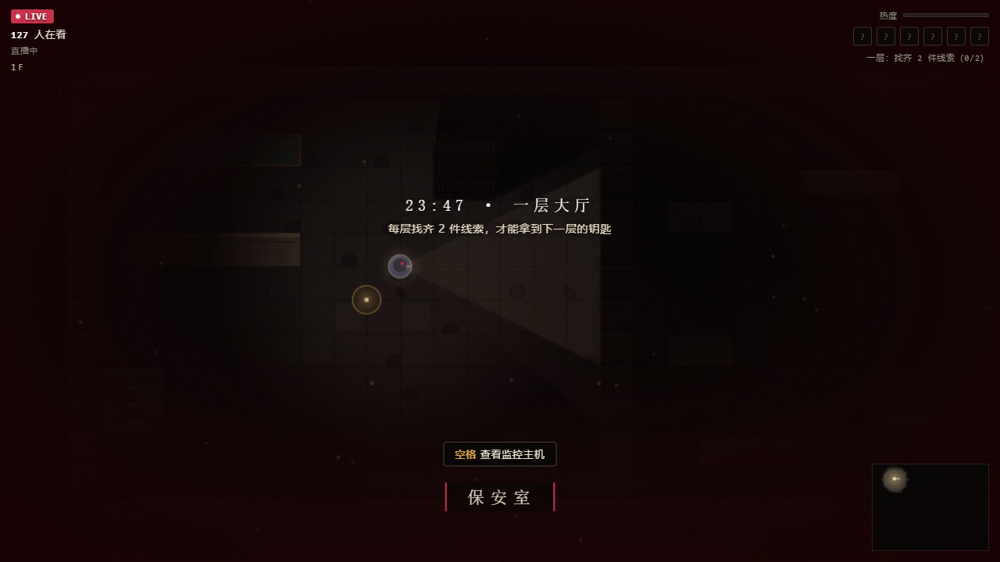

# 封校第七十三天 · 后夜直播

**在线玩：<https://cyzhou2.github.io/school-horror2/>**

一个网页恐怖小游戏：一支为了流量翻进封闭中学的直播小队，在一栋三层教学楼里找齐六件证据，顺便被“她们”追。

- **双击 `index.html` 就能玩**（纯前端，零依赖、零安装、不联网）
- 键盘 + 手机触屏都能玩，一周目约 15–20 分钟
- 画面与音效全部由代码实时生成，没有外部图片/音频文件

> 仓库：`cyzhou2/school-horror2`（当前版本 v4）。v1（单层、三线索、一只鬼）在旧仓库 `cyzhou2/school-horror`。



---

## 怎么玩

### 键盘

| 按键 | 作用 |
|---|---|
| `WASD` / `方向键` | 移动 |
| `Shift` | 奔跑（很快，但**声音传得很远**） |
| `空格` / `E` | 互动：看线索、躲藏、关防火门、推桌椅、开关门 |
| `F` | 手电筒开关（关灯更难被发现，但看不清路） |
| `L` | 开/关直播（热度会掉，鬼会安静下来） |
| `M` | 静音 |
| `Esc` | 暂停 |

### 手机

左下虚拟摇杆移动，右下三个按钮：**跑**（按住）、**互动**、**关播**。

---

## 这栋楼怎么走

**每层都是一圈环形走廊**（北 / 南 / 东 / 西四条腿，拐角有空场），房间贴着外圈，两座楼梯间在**斜对角**（北东 / 南西）。

```
┌──────────────────────────────────────────┐
│  房间    房间    房间      北楼梯间        │
├───────┬──────────────────────┬───────────┤
│       │                      │           │
│  北走廊 │   （1F 是中央大厅）    │  东走廊   │
│       │                      │           │
├───────┴──────────────────────┴───────────┤
│  南楼梯间   房间    房间      房间         │
└──────────────────────────────────────────┘
```

- 走廊是**闭合的环**，拐角会切断视线——被追的时候绕一圈就能甩开
- **两座楼梯间在斜对角**，一把钥匙同时开两处；一座被堵，就走另一座
- 锁装在**楼梯间内部**（拦住梯段），所以进出楼梯间永远自由，只是上楼要钥匙——不会出现“上楼后被锁在楼梯间里”

每层 2 件线索，凑齐才会“想起钥匙在哪”，拿到钥匙才能上下一层：

| 楼层 | 两件线索 | 锁 → 钥匙 |
|---|---|---|
| 1F | 监控硬盘（保安室）、拖把架上的缺口（器材室） | 消防门 ← 保安室钥匙串（值班表下面） |
| 2F | 没寄出的信（三年二班）、广播录音带（广播室） | 电子门禁 ← 教务处门禁卡 |
| 3F | 手机里的 47 秒（储物间）、椅背上的校服（教师办公室） | 断电连锁门 ← 配电间保险丝 |


---

## 两只鬼，两套规则

**快鬼**（第一章就在）：巡逻 → 听声 → 追逐 → 搜寻。

- **比你走路慢**：追逐时最高 101，你走路 104，跑起来 186 —— **只要跑就能拉开**
- 它在**你视野之外也能锁定你**（不需要你看见它，它一直在看），所以它经常是从你没照到的那一头悄悄靠近
- 但**拉远就脱战**：距离超过约 470 像素，两秒多它就丢失你，转为搜寻
- **躲柜子能骗过它**，它发现你的瞬间会停顿半秒并给一声提示音

**慢鬼**（第 6 件线索后从北侧楼梯间走上来）：

- 不冲刺、不加速，永远走最短路 —— **甩不掉，但也慢**（76）
- 它存在的目的不是抓你，是**不让你原地磨**：你停下研究线索，它就在逼近
- **躲藏对它无效**：它会走到你柜门外站着，数到 6 就开门
- **会破门**：关着的防火门它要撞 8 秒，桌椅堆要拆 12 秒
- **会跟着你换楼层**：你上楼后大约 7 秒，楼梯口才会传来它的脚步声

### 你能拿它怎么办

| 手段 | 位置 | 效果 |
|---|---|---|
| 关防火门 | 每层走廊，共 2 扇 | **每扇只能关一次**；门一关，光就照不过去，它也就看不见你（双向） |
| 推桌椅堵门 | 每层走廊 1 处 | 挡它一阵；**它得自己拆**，或你**再按一次互动键把桌椅挪开** |
| 躲进柜子 | 各房间 | 只对快鬼有效；对慢鬼等于自杀 |
| 跑 | — | 186 vs 101，一定能拉开 |

**门是一次性的**：关上能挡它 8 秒；但你要从关门的那一侧出去，只能把门硬拉开——铰链一坏，这扇门就永远关不上；它自己撞开的门也一样。

**桌椅是可再用的**：它自己不会塌，你不挪它就一直堵着；鬼把桌椅拆散之后就彻底没了。

### 耳朵比眼睛可靠

**心跳**是核心提示音：两只鬼里**离你最近的那只**决定它 —— 越近，心跳越快、越重，近到一定程度还会混进你自己的呼吸声。看不到它的时候，靠心跳判断方向。

### 视野规则

- 光照是**射线投影**：墙、关着的门、高柜、书架、文件柜、水箱都会切断光，门后是真黑
- **低矮家具不挡视线**：课桌、纸箱、柜台、洗手台、长条实验台**以及桌椅堆**只挡路，挡不住你和它的视线
- 躲进柜子时视野变成一条**横向门缝**，同样受墙和门限制
- 站在门格里关门会被拒绝；万一被关进实体，会自动挪到最近的可站立点
- **右下角的小地图**只亮你已经走过的地方，其余全是雾；亮点是你，短线指朝向

---

## 队友只在耳机里

小周（摄影）和灵灵（策划）不出现在画面里，只有对讲机字幕和弹幕。拿到 2F 门禁卡之后，**对讲机会失联**，之后只剩电流、零碎的半句话，以及偶尔一句不知道是谁在说。

---

## 五个结局

| 结局 | 条件 |
|---|---|
| **真** | 六件线索全发出去，点名队友 |
| **半真** | 线索不全也发 → 舆论反噬，学校反手告你 |
| **黑** | 删掉一切，回去涨粉 |
| **隐藏** | 全程几乎没开播（累计开播 < 30 秒）→ “关掉手机，安静地离开” |
| **消失** | 被抓**三次** → 画面全红，镜头里再也没有人 |

## 死亡惩罚：画面越来越红

**跟粉丝数、跟手电筒都没关系了。**

每死一次，屏幕边缘就更猩红一层（第二层开始还会缓慢脉动）。线索、钥匙、门的状态全部保留，不倒退进度。

**第三次死亡直接进入结局「消失」**：镜头被撞翻，画面里没有人，直播还在继续，卷宗上写的是「失踪」。

## 人气是把双刃剑

热度不只是“鬼更兴奋”这种看不见的数字，它有两个**看得见摸得着**的后果：

- **手机在震**：人气超过 32 后，手机会周期性震动——每震一次就是一次噪音事件，直接把鬼往你这边引。HUD 会显示「手机在震（人气过高）」。
- **观众报点**：同样是高人气，观众会在鬼靠近时用弹幕喊方向。所以你是在“用噪音换情报”。
- 热度也会让快鬼的视线更远、更快一点，但**永远快不过你走路**。

想安静就按 `L` 关播：热度会掉、手机不震了，但报点也没了。

---

## 项目结构

```
schoolHorror/
├─ index.html        # 页面骨架、HUD、各种覆盖层
├─ styles.css        # 全部界面样式（含手机适配）
├─ js/
│  ├─ data.js        # 数值、三层楼地图与物件、六件线索全文、钥匙/锁、弹幕池、结局
│  ├─ audio.js       # Web Audio 合成：环境嗡鸣、脚步、心跳、破门、对讲机电流
│  ├─ world.js       # 多楼层地图、动态门/锁/堵门碰撞、视线、BFS 寻路
│  ├─ input.js       # 键盘 + 触屏摇杆
│  ├─ render.js      # Canvas 绘制、手电筒光照、柜门缝视野、门与楼梯
│  ├─ actors.js      # 玩家、快鬼（含撞门）、慢鬼（数柜门 / 破门 / 换层跟随）
│  ├─ stream.js      # 直播：人数、热度、弹幕与危险提示
│  └─ game.js        # 主循环、楼层切换、钥匙链、对讲机、死亡重试、四个结局
└─ README.md
```

## 想改数值？

基本都在 `js/data.js` 顶部的 `CFG`：

```js
PLAYER_SPEED: 104,   // 走路速度
PLAYER_RUN: 186,     // 奔跑速度
GHOST_SIGHT: 250,    // 快鬼视野（开手电 +80，关手电 -50）
GHOST_CHASE: 146,    // 快鬼追逐速度
SLOW_SPEED: 92,      // 慢鬼速度（比走路慢一点，所以“甩不掉但也不快”）
SLOW_HIDE_COUNT: 6,  // 慢鬼在柜门外数到几秒开门
FIREDOOR_BREAK: 8,   // 慢鬼撞开防火门要几秒
BARRICADE_HOLD: 12,  // 桌椅能撑几秒
```

房间、物件、线索文本在同一个文件里往下翻：`LEVELS`、`KEYS`、`LOCKS`、`CLUES`、`DANMAKU`、`STORY`。

## 兼容性

- Chrome / Edge / Firefox / Safari 现代版本。
- `file://` 直接双击可用（没有任何模块化加载与 fetch）。
- 首次点击“开始直播”后才会启动音频（浏览器自动播放策略）。

## 已知限制

- 慢鬼不做真正的跨层寻路：它用“延迟到达楼梯口”来模拟上下楼。
- 只有一层楼里的一只快鬼 + 一只慢鬼，没有第三只。
- 没有存档进度（只把结局记录在 localStorage）。
- 无配音、无英文版本。
