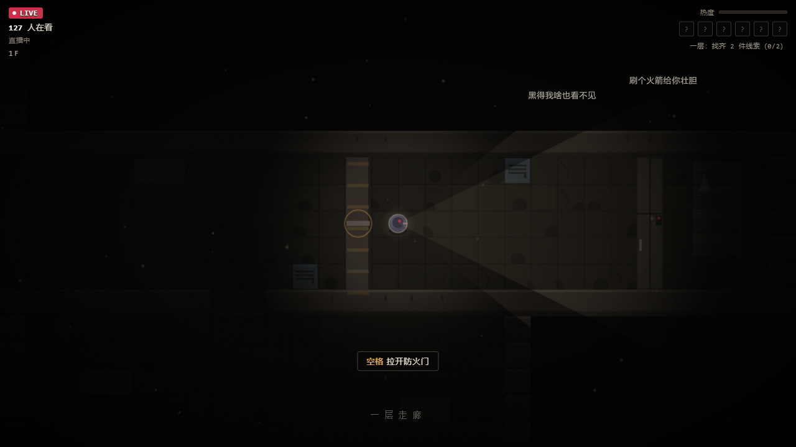

# 封校第七十三天 · 后夜直播

一个网页恐怖小游戏：一支为了流量翻进封闭中学的直播小队，在一栋三层教学楼里找齐六件证据，顺便被“她们”追。

- **双击 `index.html` 就能玩**（纯前端，零依赖、零安装、不联网）
- 键盘 + 手机触屏都能玩，一周目约 15–20 分钟
- 画面与音效全部由代码实时生成，没有外部图片/音频文件

> 当前工作区在 **v2** 分支。v1（单层、三线索、一只鬼）在 `main` 分支与 `v1.0` 标签里，随时 `git checkout main` 回去。



---

## 怎么玩

### 键盘

| 按键 | 作用 |
|---|---|
| `WASD` / `方向键` | 移动 |
| `Shift` | 奔跑（很快，但**声音传得很远**） |
| `空格` / `E` | 互动：看线索、躲藏、关防火门、推桌椅、开关门 |
| `F` | 手电筒开关（关灯更难被发现，但看不清路） |
| `L` | 开/关直播（热度会掉，鬼会安静下来） |
| `M` | 静音 |
| `Esc` | 暂停 |

### 手机

左下虚拟摇杆移动，右下三个按钮：**跑**（按住）、**互动**、**关播**。

---

## 这栋楼怎么走

三层楼，每层 2 件线索，凑齐才会“想起钥匙在哪”，拿到钥匙才能开下一层的锁：

| 楼层 | 房间 | 两件线索 | 锁 → 钥匙 |
|---|---|---|---|
| 1F | 大厅、保安室、体育器材室 | 监控硬盘、值班记录本 | 消防门 ← 保安室钥匙串 |
| 2F | 三年二班、女厕、广播室、教务处、教师办公室 | 没寄出的信、广播录音带 | 电子门禁 ← 教务处门禁卡 |
| 3F | 三层储物间、教师办公室、配电间 | 手机里的 47 秒、椅背上的校服 | 断电连锁门 ← 配电箱保险丝 |

楼梯在走廊最东头，开门后走上去；上楼/下楼会弹出选择。

---

## 两只鬼，两套规则

**快鬼**（第一章就在）：巡逻 → 听声 → 追逐 → 搜寻。**躲柜子能骗过它**，它发现你的瞬间会停顿半秒并给一声提示音。

**慢鬼**（第一次上三楼时出现）：
- 不冲刺、不加速，永远走最短路——**甩不掉，但也不快**（比你走路慢一点点）
- **躲藏对它无效**：它会走到你柜门外站着，数到 6 就开门
- **会破门**：关着的防火门它要撞 8 秒，桌椅堆要拆 12 秒
- **会跟着你换楼层**：你上楼后大约 7 秒，楼梯口才会传来它的脚步声
- 隔着一层楼也能听见它拖沓的脚步

### 你能拿它怎么办

| 手段 | 位置 | 效果 |
|---|---|---|
| 关防火门 | 每层走廊，共 2 扇 | 挡它约 8 秒；**门一关，光就照不过去，它也就看不见你**（双向） |
| 推桌椅堵门 | 每层走廊 1 处，仅一次 | 挡它 12 秒，之后散开 |
| 躲进柜子 | 各房间 | 只对快鬼有效；对慢鬼等于自杀 |
| 跑 | — | 比它快，但会引来快鬼、也会耗体力 |

### 视野规则

- 光照是**射线投影**：墙、关着的门、高柜都会切断光，门后是真黑
- **低矮家具不挡视线**：课桌、纸箱、柜台、洗手台只挡路，挡不住你和它的视线
- 躲进柜子时视野变成一条**横向门缝**，同样受墙和门限制

---

## 队友只在耳机里

小周（摄影）和灵灵（策划）不出现在画面里，只有对讲机字幕和弹幕。拿到 2F 门禁卡之后，**对讲机会失联**，之后只剩电流、零碎的半句话，以及偶尔一句不知道是谁在说。

---

## 四个结局

到天台前的选择决定结局：

| 结局 | 条件 |
|---|---|
| **真** | 六件线索全发出去，点名队友 |
| **半真** | 线索不全也发 → 舆论反噬，学校反手告你 |
| **黑** | 删掉一切，回去涨粉 |
| **隐藏** | 全程几乎没开播（累计开播 < 30 秒）→ “关掉手机，安静地离开” |

## 死亡惩罚：手电筒会摔坏

被抓不是没代价的：

- 每死一次，**手电筒亮度掉一档**：196 → 168 → 142（最低一档，不会归零）
- 每层藏着一块**备用电池**（器材室 / 教师办公室 / 配电间），捡到补回一档
- 视野变小是永久的（直到你找到电池），所以“摸黑硬闯”的代价会累积
- 线索、钥匙、锁的状态全部保留，**不倒退进度**

---

## 项目结构

```
schoolHorror/
├─ index.html        # 页面骨架、HUD、各种覆盖层
├─ styles.css        # 全部界面样式（含手机适配）
├─ js/
│  ├─ data.js        # 数值、三层楼地图与物件、六件线索全文、钥匙/锁、弹幕池、结局
│  ├─ audio.js       # Web Audio 合成：环境嗡鸣、脚步、心跳、破门、对讲机电流
│  ├─ world.js       # 多楼层地图、动态门/锁/堵门碰撞、视线、BFS 寻路
│  ├─ input.js       # 键盘 + 触屏摇杆
│  ├─ render.js      # Canvas 绘制、手电筒光照、柜门缝视野、门与楼梯
│  ├─ actors.js      # 玩家、快鬼（含撞门）、慢鬼（数柜门 / 破门 / 换层跟随）
│  ├─ stream.js      # 直播：人数、热度、弹幕与危险提示
│  └─ game.js        # 主循环、楼层切换、钥匙链、对讲机、死亡重试、四个结局
└─ README.md
```

## 想改数值？

基本都在 `js/data.js` 顶部的 `CFG`：

```js
PLAYER_SPEED: 104,   // 走路速度
PLAYER_RUN: 186,     // 奔跑速度
GHOST_SIGHT: 250,    // 快鬼视野（开手电 +80，关手电 -50）
GHOST_CHASE: 146,    // 快鬼追逐速度
SLOW_SPEED: 92,      // 慢鬼速度（比走路慢一点，所以“甩不掉但也不快”）
SLOW_HIDE_COUNT: 6,  // 慢鬼在柜门外数到几秒开门
FIREDOOR_BREAK: 8,   // 慢鬼撞开防火门要几秒
BARRICADE_HOLD: 12,  // 桌椅能撑几秒
```

房间、物件、线索文本在同一个文件里往下翻：`LEVELS`、`KEYS`、`LOCKS`、`CLUES`、`DANMAKU`、`STORY`。

## 兼容性

- Chrome / Edge / Firefox / Safari 现代版本。
- `file://` 直接双击可用（没有任何模块化加载与 fetch）。
- 首次点击“开始直播”后才会启动音频（浏览器自动播放策略）。

## 已知限制

- 慢鬼不做真正的跨层寻路：它用“延迟到达楼梯口”来模拟上下楼。
- 只有一层楼里的一只快鬼 + 一只慢鬼，没有第三只。
- 没有存档进度（只把结局记录在 localStorage）。
- 无配音、无英文版本。
